
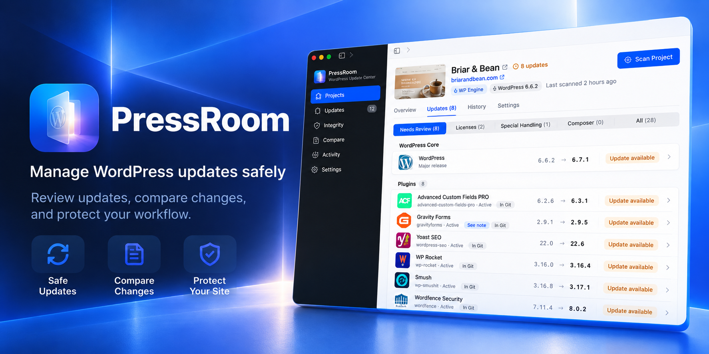

<a href="https://github.com/jeffcalaway/pressroom/releases/latest"><b>Download PressRoom for Mac</b></a> · macOS 14 Sonoma or later

---

PressRoom looks after the WordPress sites you build on your Mac. It finds what needs updating, applies updates one at a time with a safety net under each one, checks that your site still works afterward, and lets you undo anything with one click. It can also compare your local site with staging or production, and find files left behind on your servers.

Everything happens on your Mac. There's no account, no subscription, and nothing is sent anywhere except the update checks WordPress already makes.

## Contents

- [Install](#install)
- [Your first project](#your-first-project)
- [What PressRoom does](#what-pressroom-does)
  - [Projects and scans](#projects-and-scans)
  - [Groups](#groups)
  - [Updates](#updates)
  - [Saved licenses](#saved-licenses)
  - [Applying updates safely](#applying-updates-safely)
  - [Before-and-after screenshots](#before-and-after-screenshots)
  - [Compare environments](#compare-environments)
  - [Integrity: leftover files on your servers](#integrity-leftover-files-on-your-servers)
  - [Notifications](#notifications)
  - [The menu bar icon](#the-menu-bar-icon)
  - [Settings](#settings)
  - [Keeping PressRoom up to date](#keeping-pressroom-up-to-date)
- [Privacy and safety](#privacy-and-safety)
- [Troubleshooting](#troubleshooting)
- [License](#license)

## Install

1. [Download the latest **PressRoom DMG**](https://github.com/jeffcalaway/pressroom/releases/latest) (the file ending in `.dmg`).
2. Open it. A window like this appears:

   
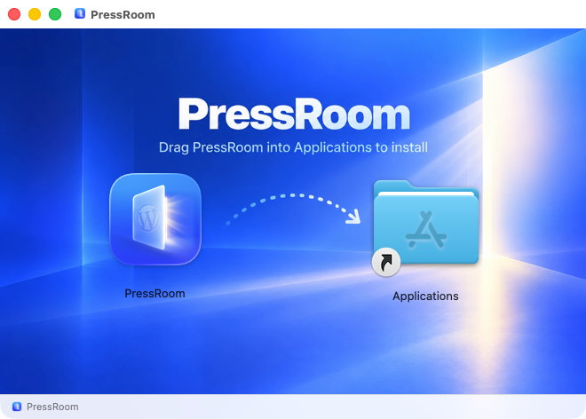

3. Drag **PressRoom** onto **Applications**.
4. Open PressRoom from your Applications folder (or Launchpad, or Spotlight).

**The first time you open it,** macOS shows a message titled **"PressRoom" Not Opened**, saying *Apple could not verify "PressRoom" is free of malware.* That's because PressRoom isn't registered with Apple's paid developer program, not because anything is wrong. To open it:

1. Click **Done**, not Move to Trash.
2. Open **System Settings › Privacy & Security**.
3. Scroll to the **Security** section near the bottom. Next to *"PressRoom" was blocked to protect your Mac*, click **Open Anyway**.
4. Enter your password or use Touch ID, then click **Open**.

Right-clicking the app and choosing Open doesn't skip this on recent versions of macOS; Open Anyway is the way.

You only need to do this once. After that, PressRoom opens normally and keeps itself up to date.

### What you'll need

- A Mac with **macOS 14 Sonoma** or later.
- WordPress sites on your Mac, run with **[Local](https://localwp.com)**, **[MAMP](https://www.mamp.info)**, or your own PHP and MySQL.
- **[WP-CLI](https://wp-cli.org)**. Local already includes it. If your Mac doesn't have it, PressRoom installs the official copy for its own use when you add a project (no password needed, and nothing else on your Mac changes).
- For the server features (Integrity, and comparing with staging or production): SSH access to your servers, and optionally a GitLab account.

## Your first project

The first time you open PressRoom, a short welcome introduces it: what it does, how updates work, and a few choices worth making up front (notifications, the menu bar icon, opening at login, and automatic updates). It then offers the **PressRoom Tour**: a guide's cursor sets PressRoom up while you watch, on a few made-up sites, the way a colleague would show you a first session. It adds the sites and groups a client's together, decides how a customized plugin should update, saves a premium plugin's license and adds it to a site in one click, picks the pages each update checks, runs an update (adding that license when the update needs it, catching a broken page, and undoing it in one click), reviews the before-and-after screenshots, cleans up a server's leftover files, and compares local with production. Each click lights up where it lands and each step says why in a sentence or two. Steps play on their own (choose Relaxed, Normal, or Brisk, or turn Autoplay off and press Next), Space pauses, Back plays a step again, and the milestones along the bottom jump to any part. When it ends, **Restart** plays it again on fresh made-up sites. It's entirely simulated (your projects, sites, servers, and settings aren't touched, and the made-up sites are deleted afterward), and you can leave it at any point. Take it again any time from **Settings › General › Feature tour** or **Help › PressRoom Tour**, or watch just one feature on its own with **Tour a Feature**; the welcome is under **Help › Welcome Tour**.

  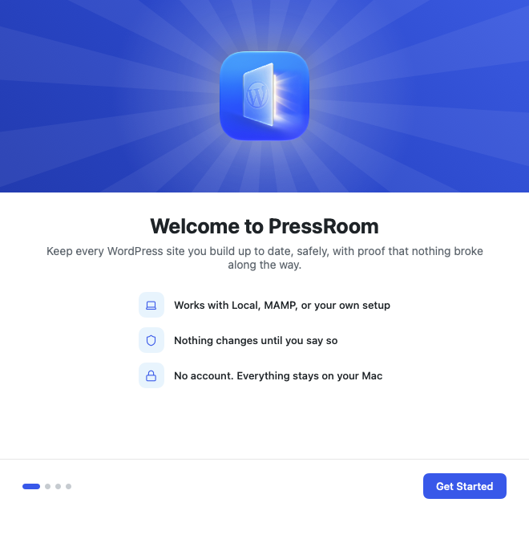
  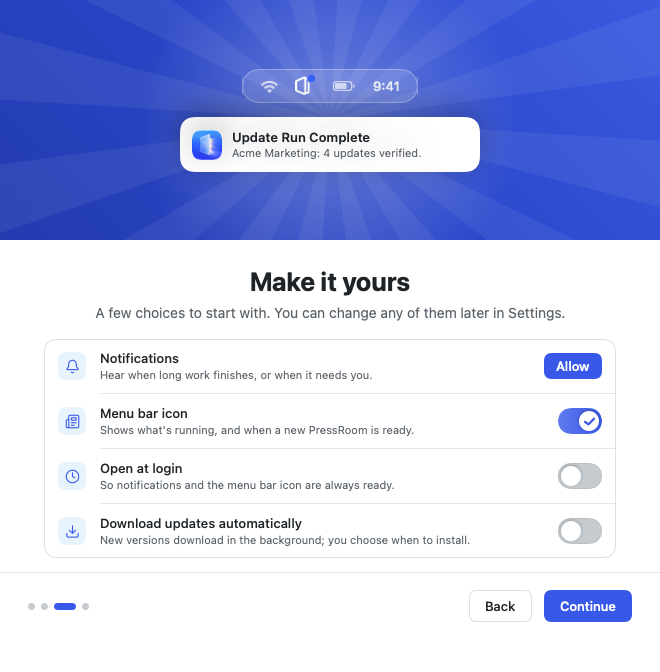

To add a project:

1. Click **Add Your First Project** at the end of the tour, or **Add Project** any time.
2. Choose the folder of a WordPress site on your Mac. PressRoom recognizes Local, MAMP, and most other setups, and picks the PHP version your site actually uses.
3. If your Mac doesn't have WP-CLI, PressRoom downloads it for you. Then it tests the connection: it checks PHP, WP-CLI, your WordPress files, and the database, without changing anything. If something's off, it tells you what and how to fix it (for example, "Local's database isn't running, so start the site in Local").
4. Click **Add**. PressRoom scans the site and shows what's out of date.

That's it. Until you add one, PressRoom shows this:

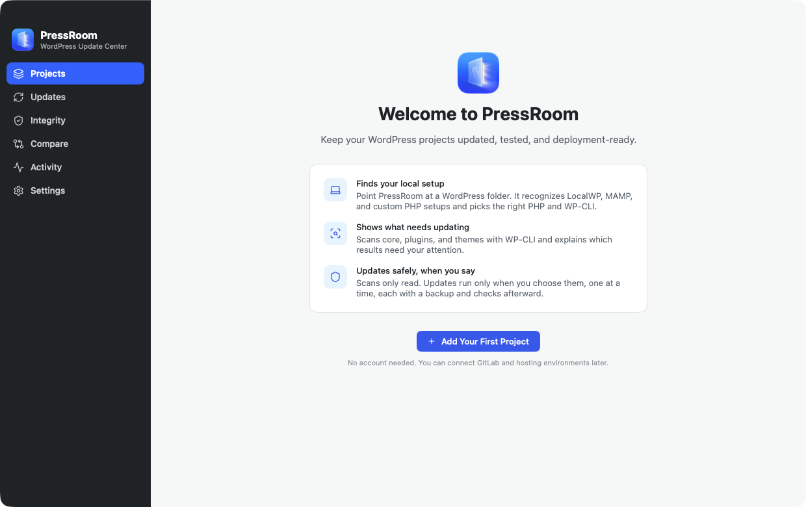

Every project you add appears in **Projects**, and the sidebar takes you everywhere else.

### Adding several sites at once

Have a folder full of sites? Click **Add Several…** on the Projects page (or **File › Add Several Projects…**, ⇧⌘N) and choose **Sites in Local** or **Sites in a Folder…**, such as `~/Sites` or MAMP's `htdocs`. PressRoom finds every WordPress site there (looking two levels deep), detects each one's environment, and lists them with a switch each. Sites already in PressRoom are marked so they aren't added twice. Choose a **Group** to put them in, if you like, then click **Add**, and PressRoom scans each new project, a few at a time.

## What PressRoom does

### Projects and scans

A **scan** reads a site and lists its WordPress version, plugins, and themes, with what's out of date. Scans only read; they never change anything.

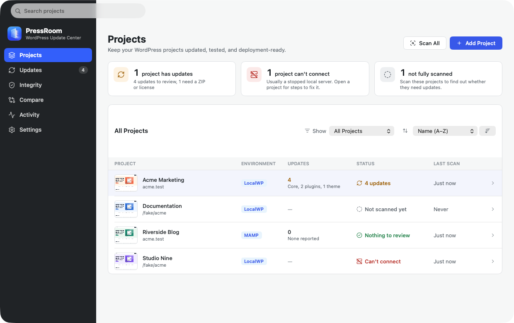

- Each project shows its health at a glance: up to date, updates waiting, or a problem to look at.
- PressRoom spots premium plugins whose license isn't active (ACF PRO, Gravity Forms, Elementor Pro, SearchWP, and more) and links straight to the right settings page in your site's admin.
- It notices plugins managed by Composer, files committed to Git, and plugins that need a newer PHP or WordPress, and says so before you try to update them.
- **Scan All** on the Updates page scans every project at once, with a progress card for each.

### Groups

Keep related projects together, such as one client's sites, or a team's. Click **New Group** on the Projects page, type its name, and drag projects onto it (or right-click a project and choose **Move to Group**). You can also pick a group when you add a project, or in its **Settings**.

- Click a group to fold it away; its header still says how many projects it has and how many need attention.
- Drag projects and groups into any order. Dragging switches **Sort by** to **Your order**; other orders sort the projects inside each group.
- Click a group's color square to recolor it: one of the presets, any hex code (such as `#E0563B`), or a color from the color picker. Its menu renames it, scans its projects, or deletes it (its projects stay, in no group).
- PressRoom remembers your groups, their order, and which are folded, even after you quit.

Click a project to open it. **Overview** shows what's waiting and anything that needs you first, like a license to activate:

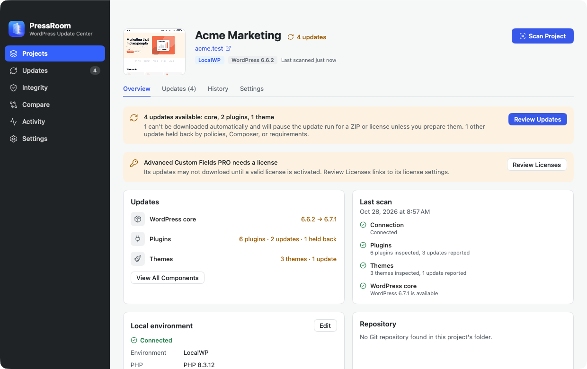

### Updates

The **Updates** page lists everything that can be updated across all your projects, and each project's **Updates** tab lists its own:

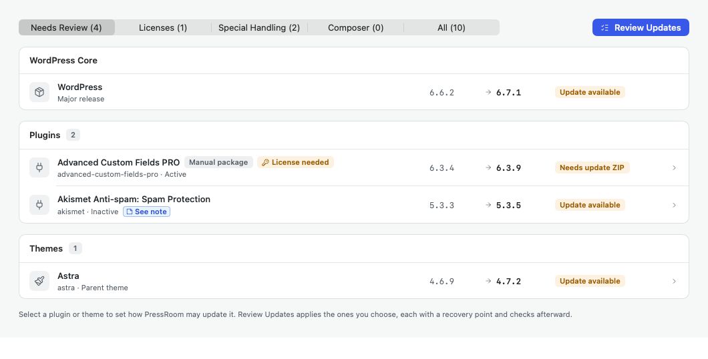

Click any plugin or theme to choose how it should be handled:

- **Update Normally:** PressRoom updates it from WordPress.org or the plugin's own update service.
- **Never Update:** for plugins you've customized or need to keep on a certain version. PressRoom won't touch them, ever.
- **Require Manual Package:** for plugins you download yourself. PressRoom asks for the ZIP and checks it's the right plugin and a newer version before installing it.

You can leave a note on any plugin (for example, "Don't update past 6.2: breaks the booking form"), and PressRoom shows it wherever that plugin appears.

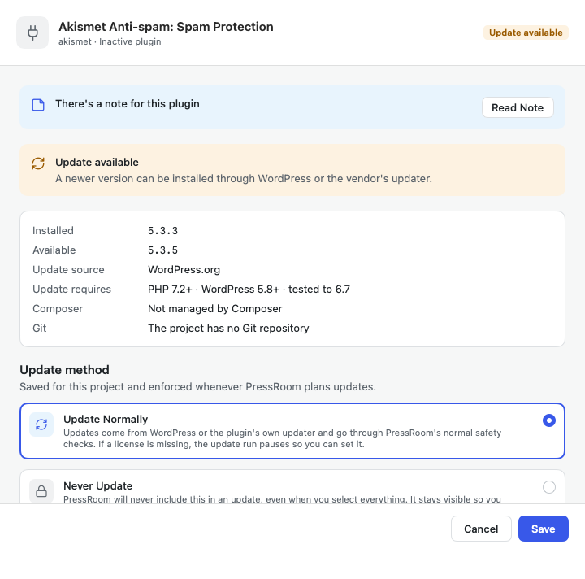

### Saved licenses

Save a premium plugin's license once, and add it to any project's site in a click. Open **Licenses** in the sidebar and click **Save a License**: choose the plugin (PressRoom lists the premium plugins it found in your projects first), paste the key, and choose which projects may use it. Optional details help you find and renew it: **Tags** (type one and press Return; tags you've used before are suggested, the Licenses page filters by them, and right-clicking one changes its color or deletes it), the **Vendor account** you sign in with on the vendor's website, the **Vendor website** itself (linked from the license), an expiry date, and how many sites it covers.

When a project's plugin needs its license and it may use one you saved, PressRoom asks, on the project's Overview, its Updates tab, the plugin's details, the update plan, and when an update run pauses for that license. **Add Saved License** puts the key into the plugin on your local site (ACF PRO, Gravity Forms, Elementor Pro, SearchWP, WP All Import Pro, and WP All Export Pro), then scans the site to confirm the vendor accepts it. From a paused run, it tries the download again once the license is in. For other plugins, PressRoom copies the key and opens the plugin's license page for you to paste it.

- **Keys are locked with Touch ID.** Each key is sealed by your Mac's Secure Enclave, and only Touch ID (or your Mac's password) opens it, whether PressRoom is adding it to a site or showing or copying it; one fingerprint covers a couple of minutes. Keys are never written in plain text or logged, PressRoom shows only their last four characters, and a copied key is cleared from the clipboard after 90 seconds. Because the Keychain isn't involved, updating PressRoom never asks for your password. (On a Mac without a Secure Enclave, keys are kept in the Keychain.)
- **You decide where each license goes.** Allow it for every project, or only the ones you choose, on the Licenses page or in each project's **Settings › Licenses**.
- The Licenses page lists every site ready for a saved license (with **Add All**). Each license can show the projects that have its plugin (folded away until you open it, with a one-line summary), what their sites report, and when PressRoom added it.
- Only your local sites are changed, and only when you click. Staging and production aren't touched.

### Applying updates safely

Choose the updates you want and click **Review Updates**. PressRoom shows what will change, what will be backed up, and anything that will need you along the way:

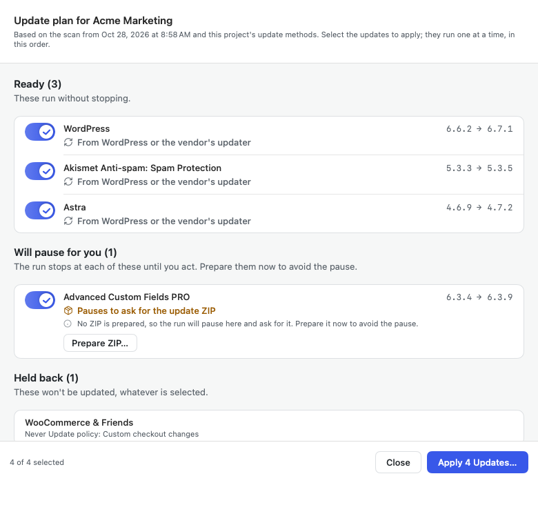

Then it applies the updates one at a time:

1. **Before anything changes,** it checks the site is working, makes sure there's enough disk space, and exports your database (always for WordPress core updates; optional otherwise).
2. **Before each update,** it copies the files that are about to be replaced, uncommitted Git changes included. Like `wp plugin update`, the update goes ahead over uncommitted changes; the report says which files had them, and **Restore Previous Files** brings them back.
3. **After each update,** it checks that WordPress still loads, the right version is installed, your pages respond as they did before, and no new PHP errors appeared.

If an update needs something from you (a license, a ZIP, or your site was stopped partway through), the run **pauses** and asks, rather than failing. If you've saved that plugin's license, one click adds it and tries again. Plugins that depend on another plugin are updated after it, and skipped if it couldn't be updated.

When the run is done you get a **report**: each update with what passed, what failed, and the evidence. Here, a slider plugin's update installed fine but logged a new PHP warning:

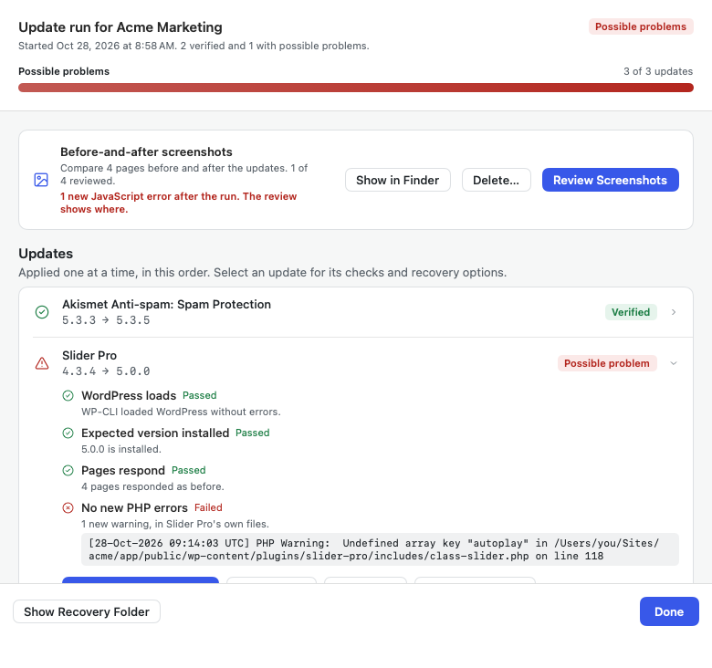

If something broke, **Restore Previous Files** puts the plugin back as it was, and **Restore Database** restores the export from before the run. If you stopped a run, or quit PressRoom in the middle of one, **Resume Remaining Updates** picks up where it left off.

**Updating several projects.** Click **Update Projects…** on the Updates page (or **Project › Update Projects…**, ⇧⌘U), choose the projects, and PressRoom updates them one at a time, each with the same safety net and its own report. By default it applies only the updates that run without stopping, so you can leave it running; turn on **Include updates that need a ZIP or a license** to have it pause for those. You can close the window while it works: the Updates page shows how far it's got, and **Stop After This Project** finishes the current project and starts no more.

### Before-and-after screenshots

Turn on screenshots when you review updates, and PressRoom takes a picture of each of your key pages before the first update and after the last, on desktop and on a phone-size screen. When the run ends, **Review Screenshots** shows each page:

- **Side by Side**, a **Slider** you drag across, or **Highlight Changes**, which paints what changed in red.
- **JavaScript errors** each page throws, with any new ones pointed out, and which plugin's script caused them.
- **Ignore Areas:** drag a box over anything that changes on its own (a slider, a date, an ad) and it's left out of every future comparison of that page.

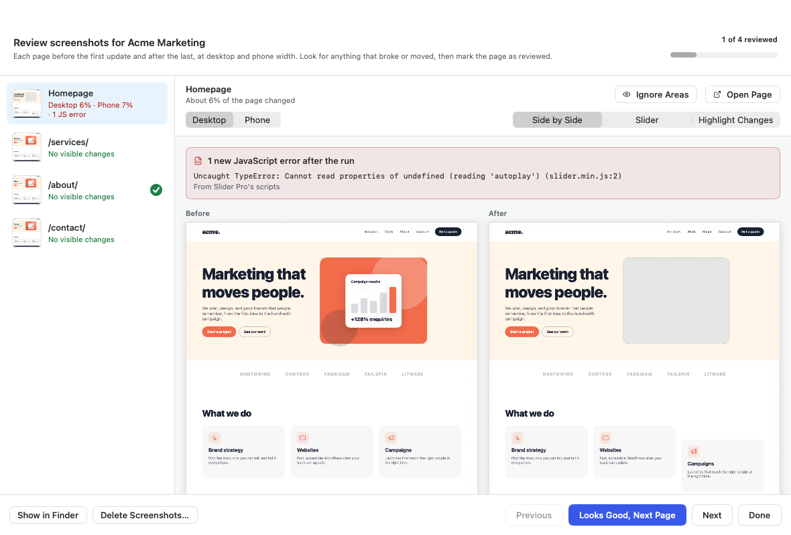

**Highlight Changes** makes the difference hard to miss:

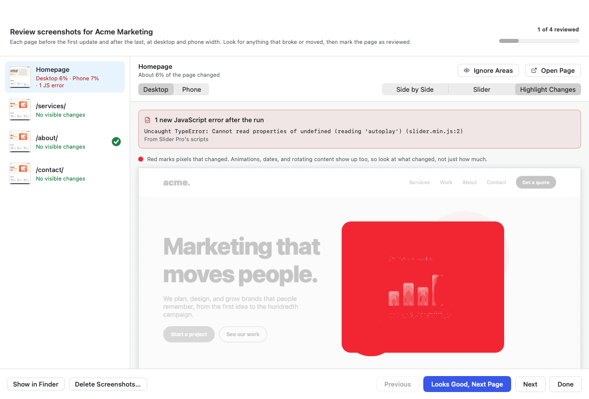

Each page is also checked at phone width, where you can mark areas to ignore:

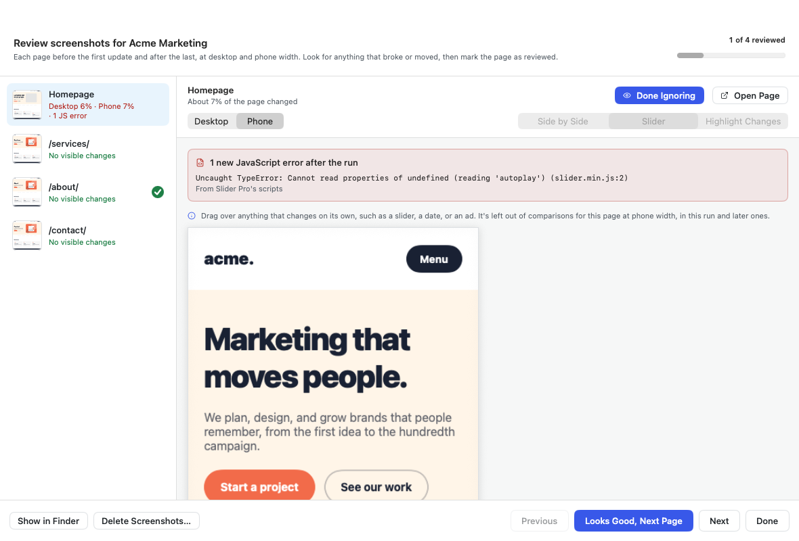

Click **Looks Good, Next Page** as you go; the list on the left shows what's left to review.

Choose which pages are checked in the project's **Settings** tab. Screenshots are temporary: delete them when you're done, or PressRoom deletes them after 14 days.

### Compare environments

**Compare** shows the same pages on two versions of a site side by side, such as your local site and staging, staging and production, or any two addresses. It's a quick way to answer "does staging look like my local site?" before you deploy, or "what's different on production?" after.

1. Choose what to compare. Compare opens on **Custom**: type any two addresses, such as the live site and a redesign, no project needed. Or pick a project to compare its environments: servers come from its `wp-cli.yml`, and their addresses are filled in when PressRoom can find them (from `wp-cli.yml`, GitLab, or WP Engine). You can still type any address with the project's **Custom** option.
2. Add the pages. The list starts empty. **Add Page** takes a path, like `/contact/`, or a full address from either site. With a project, **Import Project Pages** adds its homepage and pages to check in one click, and **Choose from Site** picks from its published content.
3. Optionally, focus on **sections**: add a CSS selector to a page, such as `header` or `.donate-form`, to compare just that part. Each page loads once, however many sections it has.
4. Optionally, **Ignore** CSS selectors for things that change on their own, like sliders or chat widgets. They're hidden on both sides.
5. Click **Compare**. PressRoom loads each page on both environments (it only looks, like a visitor) and shows which match, which look different, and which have JavaScript errors only one side throws.

Click any page for the side-by-side review. Here, staging's Services page is missing its slider and throws an error the local site doesn't:

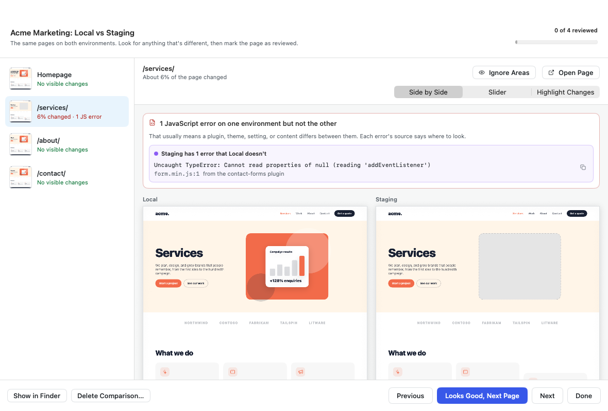

### Integrity: leftover files on your servers

When you delete a plugin or theme from your Git repository and deploy, the old files often stay on the server. **Integrity** finds them.

1. Sign in to GitLab in **Settings › GitLab** (PressRoom only reads; it can't change your repositories). PressRoom uses it to learn which version of your code each server is running.
2. Open **Integrity**, pick a project and an environment, and click **Scan**. PressRoom lists the server's files over SSH and compares them with your repository. If your server doesn't recognize this Mac yet, PressRoom walks you through setting up an SSH key.
3. Files your repository deleted that are still on the server are listed by plugin, theme, or folder, with the commit that removed them. Uploads, caches, WordPress itself, and the site's icons are never listed.

   
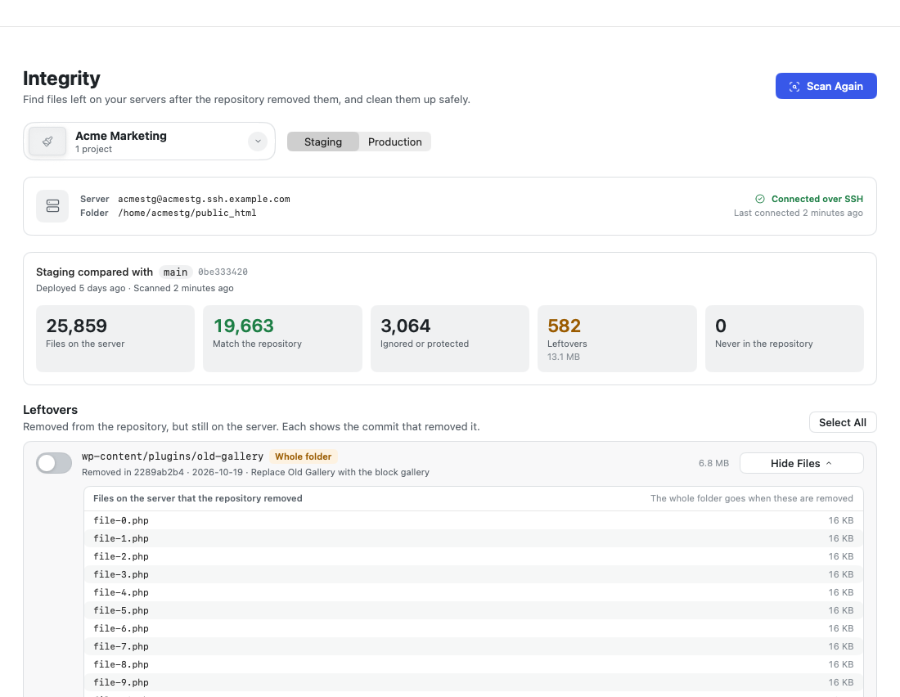

4. To clean up, choose the files and confirm. PressRoom backs them up to your Mac first, checks the backup, removes them, and checks the site still loads. **Restore** puts them back if you need to.

### Notifications

PressRoom can tell you when long work finishes: scans, update runs (and when a run needs you), integrity scans and cleanups, and comparisons. Choose which in **Settings › Notifications**. Each project can follow those settings, choose its own, or stay quiet. By default, notifications only appear when you're working in another app.

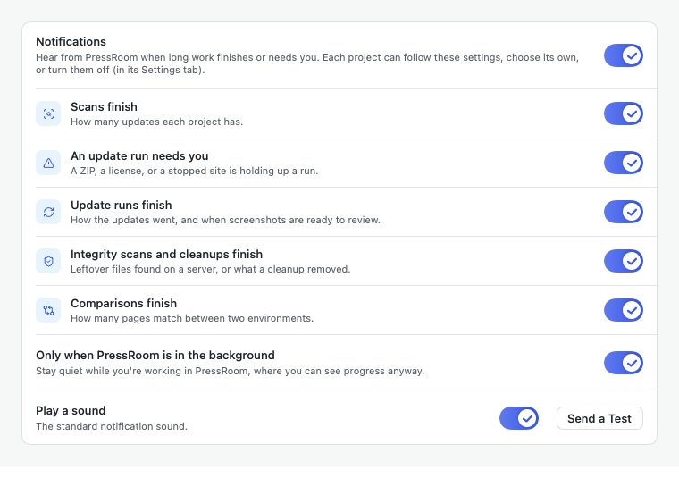

### The menu bar icon

The door icon in your menu bar shows what PressRoom is doing:

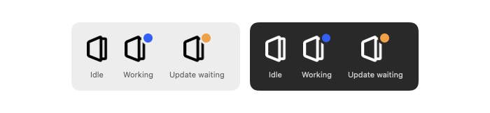

- **A blue dot** means something is running. Click the icon to see each task's progress, and click a task to jump to it.
- **An orange dot** means a new version of PressRoom is ready. Right-click and choose **Update to PressRoom…**.
- **Right-click** for quick options: open PressRoom, turn notifications on or off, Settings, Check for Updates, and Quit.

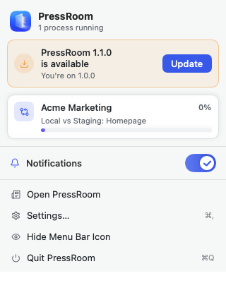

Don't want it? Choose **Hide Menu Bar Icon**; bring it back in **Settings › General**.

### Settings

- **General:** Light, Dark, or System appearance; open PressRoom at login; show or hide the menu bar icon; and **Take the Full Tour** to have PressRoom show you around again, or **Tour a Feature** to watch just one part, such as cleaning up a server (on made-up sites, so nothing real is touched).
- **Updates:** check for new versions of PressRoom automatically, and download them automatically.
- **Notifications:** what PressRoom tells you about.
- **Updates and Recovery:** export the database before update runs, take screenshots by default, and how many past runs to keep.
- **Screenshots:** how long screenshots and comparisons are kept, and how much space they use.
- **Integrity, SSH, and GitLab:** how long cleanup backups are kept, PressRoom's SSH key, and your GitLab sign-in.
- **Diagnostics:** PressRoom's log and the reports it saves when something goes wrong, with **Export…** to share them.

### Keeping PressRoom up to date

PressRoom checks for new versions shortly after it opens and every few hours. When one is available, the menu bar icon gets an orange dot. Right-click it and choose **Update to PressRoom…**: PressRoom downloads the update, checks it's genuinely from PressRoom, installs it, and opens again in a few seconds. You can also choose **PressRoom › Check for Updates…** at any time.

Prefer it hands-off? Turn on **Download updates automatically** in **Settings › Updates**, and new versions download in the background, ready when you are.

## Privacy and safety

- **Everything stays on your Mac.** No account, analytics, or tracking.
- **Scans, comparisons, and integrity scans only read.** Files change only when you apply or restore updates (on your local sites) or confirm a cleanup (on a server, after a backup).
- **License keys are locked with Touch ID.** Keys you save in PressRoom are sealed by your Mac's Secure Enclave and opened only with Touch ID or your password, to add one to a local site (sent to WP-CLI without appearing on any command line) or to show or copy it. Keys already on your sites are never read: license checks look only at whether a license is active.
- **What goes online:** WordPress's own update checks (to WordPress.org and your plugins' vendors), plugin icons (you can turn these off), GitLab (only if you sign in, read-only), your servers over SSH (only for Integrity), the pages you compare, and GitHub to check for new versions of PressRoom.
- PressRoom never commits, pushes, or fetches with Git unless you click **Fetch from origin** in Integrity.

## Troubleshooting

**PressRoom crashed, or a scan or update failed.** PressRoom keeps a diagnostics log of what it does, and saves a report on its own whenever a scan, update run, integrity scan or cleanup, or comparison fails or is stopped, or when PressRoom quits unexpectedly (with macOS's crash report, when there is one). After an unexpected quit, PressRoom says so when it opens again. To get help, open **Settings › Diagnostics** (or **Help › Export Diagnostics…**), click **Export…**, and share the `.zip` it saves. It includes site names, folder paths, and server addresses, but never passwords, keys, or license keys. Everything stays on your Mac (in `~/Library/Logs/PressRoom`) until you share it.

**macOS says "PressRoom" Not Opened.** See the [first-launch steps](#install) above: **System Settings › Privacy & Security › Open Anyway**, near the bottom.

**"WordPress couldn't connect to its database."** Your local site isn't running. Start it in Local or MAMP and try again. If this happens during an update run, the run pauses; click **Retry Update** once the site is running.

**A scan says WP-CLI or PHP wasn't found.** Open the project's **Settings** tab, click **Detect Again**, or choose PHP and WP-CLI yourself. If WP-CLI is missing, PressRoom installs it there for you; if that download fails (for example, you're offline), click **Try Again**.

**A server I added to `wp-cli.yml` doesn't show up.** PressRoom reads a project's aliases when you add it. After editing `wp-cli.yml`, click **Check Again** on the project's Overview, beside WP-CLI aliases (it's also in the project's **⋯** menu, and on the Compare and Integrity pages). New, changed, and removed aliases are listed there, and new servers appear in Compare and Integrity right away; if nothing changed, a message at the bottom of the window says so.

**Integrity says the server didn't answer.** Some hosts only accept SSH from approved addresses. PressRoom tells you if that's likely, and whether you have a VPN that isn't connected.

**An update didn't install.** Updates install only when PressRoom is in your Applications folder. If it's running from the installer or your Downloads folder, drag it into Applications, open it from there, and update again.

## License

PressRoom is free to use, including professionally, under the [PressRoom Proprietary Freeware License](LICENSE.md). Third-party components are listed in [THIRD_PARTY_NOTICES.txt](THIRD_PARTY_NOTICES.txt). WordPress and the WordPress logo are trademarks of the WordPress Foundation. PressRoom is not affiliated with the WordPress Foundation, WP Engine, Local, MAMP, GitLab, or GitHub.
